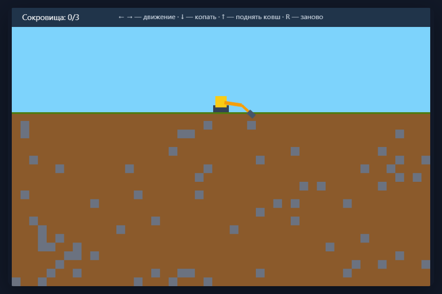

# Баскетбольный мяч — физический прототип

Индивидуальный проект курса **«Проектирование и разработка игровых приложений»**.

Стек: **TypeScript + Phaser + Vite + GitHub Pages**.

## Игра

Прототип игры про баскетбольный мяч на физике Matter.js (Phaser 4): гравитация, упругость, трение. Мяч отскакивает от пола, стен и корзины и закручивается при качении. Цель — забить мяч в корзину и пройти все 12 уровней.

### Управление

Управление только мышью:

- **ЛКМ на мяче в зоне управления** — «рогатка»: мяч появляется под курсором; зажми, оттяни и отпусти — мяч летит в противоположную сторону с силой от длины оттяжки. Вне зоны управления мяч не управляется и летит только по физике.
- **R** — начать игру заново с первого уровня
- **Esc / P** — пауза (мяч останавливается, управление блокируется)

### Механика

- Мяч появляется в центре зоны управления (синий прямоугольник); вылетел из зоны — летит по физике как брошенный.
- Физика Matter: гравитация, упругость отскока, трение (закручивает мяч при качении).
- Корзина — U-образное кольцо; гол засчитывается, когда мяч падает внутрь.
- **Фаза 2**: с 6-го уровня и до конца игры кольцо вращается вокруг своего центра, а гравитация уменьшается в 1.5 раза (в HUD появляется бейдж «ФАЗА 2»).
- 12 уровней с разными зонами управления, стенками и корзинами. Уровни 10–12 рассчитаны на рикошет: забить можно только отскоком от пола, ступеньки или стены.
- Если мяч застрял вне зоны — через несколько секунд автоматически возвращается на старт.



Задание первой практики и домашней работы: [`ASSIGNMENT_01.md`](./ASSIGNMENT_01.md).

## 1. Что нужно установить

- **Node.js 22 LTS** (или Node.js >= 20.19)
- **Git**
- **VS Code** или другая IDE
- аккаунт **GitHub**

Проверка:

```bash
node --version
npm --version
git --version
```

## 2. Первый запуск

```bash
npm install
npm run dev
```

Vite напечатает адрес локального сервера. Обычно это:

```text
http://localhost:5173/
```

Открой его в браузере.

## 3. Что менять в первую очередь

Главные файлы:

- [`src/game/GameScene.ts`](src/game/GameScene.ts) — сцена: уровни, HUD, пауза, засчитывание голов;
- [`src/game/constants.ts`](src/game/constants.ts) — все параметры игры (физика, рогатка) и описание всех 12 уровней;
- [`src/game/Ball.ts`](src/game/Ball.ts) — мяч и механика «рогатки»;
- [`src/game/Hoop.ts`](src/game/Hoop.ts) — корзина и её вращение в фазе 2.

Начинай с маленьких изменений:

1. измени поведение игрока;
2. добавь одно игровое действие;
3. добавь реакцию игры;
4. добавь цель или результат;
5. добавь препятствие / риск / условие поражения;
6. добавь Restart.

**Не начинай с меню, магазина, красивой графики и архитектуры на 30 файлов.**

## 4. Проверка production build

Перед публикацией:

```bash
npm run build
```

Если команда завершилась без ошибок, итоговая версия находится в папке `dist/`.

Её можно проверить локально:

```bash
npm run preview
```

## 5. Публикация на GitHub Pages

В репозитории уже есть workflow:

```text
.github/workflows/deploy.yml
```

После push в ветку `main` GitHub автоматически собирает проект.

Для первого включения Pages:

1. открой репозиторий на GitHub;
2. **Settings → Pages**;
3. в **Build and deployment → Source** выбери **GitHub Actions**;
4. открой вкладку **Actions** и дождись успешного `Deploy to GitHub Pages`;
5. ссылка на игру появится в deployment и в разделе Pages.

## 6. Структура проекта

```text
.
├── .github/workflows/deploy.yml   # автоматическая публикация на GitHub Pages
├── screenshots/                   # скриншоты проверки игры и уровней
├── src/
│   ├── game/
│   │   ├── Ball.ts                # мяч: физика и «рогатка» (управление мышью)
│   │   ├── Hoop.ts                # корзина: U-образное кольцо, вращение в фазе 2
│   │   ├── config.ts              # конфигурация Phaser и создание игры
│   │   ├── constants.ts           # параметры игры и все 12 уровней
│   │   └── GameScene.ts           # сцена: уровни, HUD, пауза, засчитывание голов
│   ├── main.ts                    # точка входа
│   └── style.css                  # страница вокруг canvas
├── AGENTS.md                      # правила для AI-кодинга
├── ASSIGNMENT_01.md               # задание практики
├── CHANGELOG.md                   # короткий журнал своей работы
├── TROUBLESHOOTING.md             # если что-то не запускается
├── index.html
├── package.json
├── tsconfig.json
├── vite.config.ts
└── .nvmrc                         # версия Node.js для проекта
```

## 7. AI разрешён

Можно использовать GitHub Copilot, Antigravity, Cursor или другой AI-инструмент.

Но правило курса:

> **AI может писать код. За код отвечаешь ты.**

Тебя могут попросить:

- объяснить произвольный участок кода;
- найти, где реализована конкретная механика;
- изменить правило игры;
- исправить ошибку;
- объяснить, что именно сделал AI.

Перед работой с AI прочитай [`AGENTS.md`](./AGENTS.md).

## 8. Что считается результатом первой практики

- [ ] есть индивидуальный Git-репозиторий;
- [ ] `npm run dev` запускается;
- [ ] есть основное действие игрока;
- [ ] игра реагирует на действия;
- [ ] существует хотя бы простая цель / результат;
- [ ] `npm run build` проходит без ошибок;
- [ ] есть публичная ссылка;
- [ ] другой человек попробовал игру;
- [ ] записаны минимум 3 наблюдения о его поведении.

## 9. Домашняя работа №1

Сделай **Gray-box Prototype**:

- игра открывается по публичной ссылке;
- понятна без объяснения автора;
- есть основное действие;
- есть feedback;
- есть цель / счёт;
- есть препятствие, риск или поражение;
- есть restart;
- можно осмысленно играть 1–2 минуты.

Обнови `CHANGELOG.md`.
