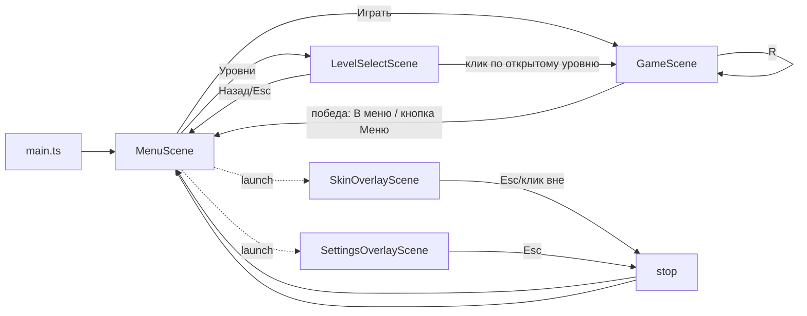

# План: меню и расширяемая система уровней (Phaser 4 + Matter)

ТЗ для код-режима. Проект: Vite + TypeScript strict + Phaser 4 (Matter).
Принципы из AGENTS.md: минимальные изменения, не ломать существующую механику,
без новых библиотек, маленькие функции, параметры — именованные константы.

---

## 0. Фактическое состояние (что выяснено в коде)

- Сцена одна — `GameScene`, старт из `createGame('game')` в `src/game/config.ts`.
- Уровни: массив `LEVELS: LevelConfig[]` (12 шт.) в `src/game/constants.ts`.
  Тип `LevelConfig = { zone, hoop, walls, ballSpawn }` — уже почти data-driven,
  но **механики зашиты в GameScene**:
  - «Фаза 2» (вращение кольца `hoop.setRotating(true)` + гравитация
    `GRAVITY_Y / PHASE2_GRAVITY_SCALE`) включается условием `levelIndex >= 5`.
  - Подсказка-траектория рисуется условием `levelIndex === 0`.
- Победа: `onScore()` → `registry.set('level', i+1)` → `scene.restart()`.
  Прогресс нигде не сохраняется; последний уровень — всегда 0 при перезапуске.
- Скин: ключ `localStorage['ballSkin']`, читается в `GameScene.create()` и
  пишется в `cycleBallSkin()`; `registry['ballSkin']` — единый источник.
- `Ball` не привязан к игре жёстко: конструктор `(scene, x, y, zone)`, зона —
  обычный прямоугольник. Единственная проблема для меню: `tryGrab()` срабатывает
  на любой `pointerdown` внутри зоны — в меню будет конфликтовать с кнопками.
- Phaser 4 Runner ускоряет физику → в `GameScene.update()` движок шагается
  вручную (`Matter.Engine.update`, `autoUpdate = false`). В меню нужен тот же
  приём — стоит вынести в общий хелпер, а не копировать.

---

## 1. Сцены и порядок запуска

### Список сцен

| Сцена | Файл | Роль |
|---|---|---|
| `MenuScene` | `src/game/MenuScene.ts` (новый) | Главное меню: 4 кнопки + физический мяч |
| `LevelSelectScene` | `src/game/LevelSelectScene.ts` (новый) | Сетка уровней с замками |
| `SkinOverlayScene` | `src/game/SkinOverlayScene.ts` (новый) | Оверлей выбора скина поверх меню |
| `SettingsOverlayScene` | `src/game/SettingsOverlayScene.ts` (новый) | Оверлей-заглушка настроек |
| `GameScene` | `src/game/GameScene.ts` (есть) | Игра, строится из описания уровня |

Оверлеи скинов и настроек — **отдельные сцены, запускаемые через
`this.scene.launch(...)` поверх `MenuScene`** (не через `scene.start`), чтобы
меню с мячом оставалось живым под полупрозрачной затемняющей подложкой.

### Схема переходов



### Изменения в точке старта

- `src/game/config.ts`: `scene: [MenuScene, GameScene, LevelSelectScene]`.
  Первая в массиве стартует автоматически — это `MenuScene`.
- `src/main.ts` не меняется.
- `GameScene` больше не читает `registry['ballSkin']` при первом запуске —
  загрузку скина берёт на себя `storage.ts` (см. §2), вызываемый из `MenuScene.create()`
  (единственная точка инициализации `registry`).

### Передача параметров между сценами

- `registry` остаётся для текущей сессии: `level` (индекс запускаемого уровня),
  `ballSkin`.
- Долговременное состояние — только `localStorage` через `storage.ts`.
- Запуск уровня: `this.registry.set('level', i); this.scene.start('GameScene')`.

---

## 2. Прогресс и настройки в localStorage (`src/game/storage.ts`, новый файл)

### Ключи и формат

```ts
// storage.ts
const PROGRESS_KEY = 'basketProgress'; // JSON ProgressData
const SKIN_KEY = 'ballSkin';           // уже используется — сохраняем совместимость

interface ProgressData {
  version: 1;            // на случай будущих миграций
  unlocked: number;      // сколько уровней открыто (индексmax + 1), старт: 1
  last: number;          // последний открытый/запускавшийся уровень, старт: 0
  completed: boolean[];  // completed[i] = уровень i пройден
}
```

`ballSkin` оставляем отдельным ключом (обратная совместимость с текущим кодом),
не тащим внутрь `ProgressData`.

### Функции-обёртки (все с `try/catch` — localStorage может быть недоступен)

```ts
loadProgress(): ProgressData          // отсутствует/битый JSON → дефолт {1, 0, []}
saveProgress(p: ProgressData): void
markLevelCompleted(index: number): void  // completed[i]=true, unlocked=max(unlocked,i+2), last=i+1
setLastLevel(index: number): void        // вызывается при запуске уровня
loadSkinId(): string | null
saveSkinId(id: string): void
```

`markLevelCompleted` и `setLastLevel` — единственные точки записи прогресса;
внутри они читают → мутируют → пишут, чтобы GameScene не знал формат JSON.

### Кто что вызывает

- `MenuScene.create()` → `loadProgress()` (кэш в поле) + `loadSkinId()` → `registry`.
- `GameScene.create()` → `setLastLevel(levelIndex)`.
- `GameScene.onScore()` → `markLevelCompleted(levelIndex)`.
- `LevelSelectScene.create()` → `loadProgress()` (для рисования замков).
- `SkinOverlayScene` → `loadSkinId()/saveSkinId()`.

---

## 3. Data-driven уровни и реестр механик

### 3.1. Новый файл `src/game/levels.ts`

Уровни — это **данные**, а не константы физики: переносим `LevelConfig`,
вспомогательные типы (`ControlZone`, `HoopConfig`, `WallConfig`) и `LEVELS`
из `constants.ts` в новый `levels.ts`. В `constants.ts` остаются только
числовые параметры физики/геометрии.

### 3.2. Расширенный тип уровня

```ts
// levels.ts
export type LevelFeatureType = 'rotatingHoop' | 'lowGravity' | 'hintTrajectory';

export interface LevelFeature {
  type: LevelFeatureType;
  params?: Readonly<Record<string, number>>; // опциональные параметры механики
}

export interface LevelConfig {
  name?: string;          // для сетки уровней, напр. «Рикошет от пола»
  zone: ControlZone;
  hoop: HoopConfig;
  walls: WallConfig[];
  ballSpawn: { x: number; y: number };
  features: LevelFeature[]; // пустой массив = «чистый» уровень
}
```

### 3.3. Реестр механик `src/game/levelFeatures.ts` (новый файл)

Ключевая идея: **GameScene не знает ни одной конкретной механики.** Он строит
базовый уровень (арена, стены, корзина, мяч) и передаёт контекст в реестр.

```ts
// levelFeatures.ts
export interface LevelContext {
  scene: Phaser.Scene;
  hoop: Hoop;
  setGravity(x: number, y: number): void; // обёртка над matter.world.setGravity
}

type FeatureHandler = (ctx: LevelContext, params: Readonly<Record<string, number>>) => void;

const FEATURE_HANDLERS: Record<string, FeatureHandler> = {
  rotatingHoop: (ctx) => ctx.hoop.setRotating(true),
  lowGravity: (ctx) => ctx.setGravity(0, GRAVITY_Y / PHASE2_GRAVITY_SCALE),
  hintTrajectory: (ctx) => drawHintTrajectory(ctx.scene), // перенос существующей функции из GameScene
};

export function applyLevelFeatures(level: LevelConfig, ctx: LevelContext): void {
  for (const f of level.features) {
    const handler = FEATURE_HANDLERS[f.type];
    if (handler) handler(ctx, f.params ?? {});
    // неизвестный type — просто игнорируем (устойчивость к опечаткам в данных)
  }
}
```

Миграция текущего поведения без изменения баланса:

- уровни 1–5, 10–12 (индексы 0–4, 9–11): `features: []`; уровень 1 —
  `features: [{ type: 'hintTrajectory' }]`;
- уровни 6–12 (индексы 5–11): `features: [{ type: 'rotatingHoop' }, { type: 'lowGravity' }]`
  — это точный эквивалент нынешнего `if (levelIndex >= 5)`.

### 3.4. Как GameScene строит уровень

`GameScene.create()` после рефакторинга:

```
1. levelIndex = registry['level'] ?? 0
2. level = LEVELS[levelIndex] (из levels.ts)
3. createArenaBounds()          — без изменений
4. createLevelObjects(level)    — стены + Hoop + Ball (как сейчас)
5. createZoneVisual(level), createHud(level)
6. applyLevelFeatures(level, ctx)  — ВМЕСТО if (levelIndex >= 5) startPhase2()
7. storage.setLastLevel(levelIndex)
```

Поля `phase2`, метод `startPhase2()` из GameScene удаляются (их заменяет
реестр). Проверка `levelIndex === 0` для подсказки тоже уходит в данные.

### 3.5. Как добавлять новое в будущем

| Задача | Что делается | GameScene |
|---|---|---|
| Новый уровень | новый объект в `LEVELS` | не меняется |
| Убрать/поменять уровень | правка/удаление объекта | не меняется |
| Включить механику на уровне | добавить элемент в `features` | не меняется |
| Новая механика | новый `type` в `LevelFeatureType` + функция в `FEATURE_HANDLERS` (+ `Hoop`/новый класс, если нужен) | не меняется |

Для механик со своим поведением в `update()` (например, движущиеся стенки):
обработчик создаёт объект-механику и сам подписывается на
`scene.events.on('update', ...)` со снятием подписки в `shutdown` — по образцу
уже существующей отписки в `Ball`.

---

## 4. Физический мяч в меню и коллизии с кнопками

### 4.1. Переиспользование `Ball`

`Ball` уже умеет всё нужное (рогатка, резинка, кулак, стрелка, скины, squash).
Меняем только способ захвата — добавляем **опциональный 4-й…5-й аргумент**:

```ts
constructor(scene, x, y, zone: ControlZone, grabGuard?: (x: number, y: number) => boolean)
// в tryGrab(): if (this.grabGuard && !this.grabGuard(px, py)) return;
```

- `GameScene` вызывает `Ball` как раньше — поведение не меняется.
- `MenuScene` передаёт зону = всё игровое поле ниже кнопок (или всё поле) и
  `grabGuard`, возвращающий `false`, если курсор над любой кнопкой меню.
  Так клик по кнопке не захватывает мяч, а клик рядом с ним — играет рогаткой.

### 4.2. Кнопки: ввод и физика раздельно

Каждая кнопка меню — класс `MenuButton` (`src/game/ui/MenuButton.ts`, новый,
маленький: контейнер `Rectangle + Text`):

- **Ввод**: `container.setInteractive()` + события `pointerover/out/down/up`
  (hover-подсветка, клик). Phaser-инпут работает по списку интерактивных
  объектов и **не зависит от Matter-тел** — физический мяч клики не перехватывает.
- **Физика**: рядом создаётся статичное Matter-тело
  `scene.matter.add.rectangle(x, y, w, h, { isStatic: true, restitution: WALL_RESTITUTION })`
  — мяч отскакивает от кнопки. Тело не привязано к GameObject, чтобы Phaser не
  трогал его transform.

### 4.3. Мир меню

- Границы арены — те же четыре статичных прямоугольника (пол/потолок/стены);
  в `MenuScene` — упрощённая копия `createArenaBounds()` либо общий хелпер
  `src/game/arena.ts` (функция `createArenaBounds(scene)`), которую используют
  обе сцены. Предпочтителен хелпер — убирает дублирование.
- Ручной шаг физики: вынести повторяющийся код GameScene в
  `src/game/matterStep.ts`: `stepMatterWorld(scene, delta)` — та же пара
  `autoUpdate = false` + `Matter.Engine.update(engine, delta)`. GameScene
  переключается на хелпер, MenuScene использует его с первого дня.
- Расположение: кнопки колонкой/сеткой в верхней трети, мяч стартует внизу;
  `BALL_RESTING_THRESH`, `MAX_SPEED` и т.п. — те же константы.
- Выбор скина мяча в меню берётся из `registry['ballSkin']` — скин в меню
  меняется сразу после закрытия оверлея (`SkinOverlayScene` обновляет registry,
  `MenuScene` при возобновлении (`resume`) создаёт мяч заново или пересоздаёт
  текстуру).

---

## 5. Экраны: поведение

### MenuScene
- Фон/рамка как в игре, кнопки: **«Играть»**, **«Уровни»**, **«Скины»**,
  **«Настройки»**.
- «Играть» → `registry['level'] = progress.last` → `GameScene`.
- «Уровни» → `LevelSelectScene`. «Скины»/«Настройки» → `scene.launch(оверлей)`.
- Мяч: рогатка работает, отскоки от кнопок и стен.

### LevelSelectScene
- Сетка кнопок 4×3 (размер сетки — константа, считать из `LEVELS.length`).
- Кнопка уровня: если `i < progress.unlocked` — активна (зелёная/белая,
  галочка если `completed[i]`); иначе — серая с «замком» (текст 🔒 или нарисованный
  прямоугольник — без новых ассетов).
- Клик по открытому → `registry['level'] = i` → `GameScene`.
- Esc / кнопка «Назад» → `MenuScene`.

### SkinOverlayScene (launch поверх MenuScene)
- Полупрозрачная подложка (`Rectangle` на весь экран, `setInteractive()` — клик
  по ней закрывает оверлей), ряд превью всех скинов из `BALL_SKINS`
  (текстуры через существующий `ensureBallTexture`).
- Клик по скину → `registry['ballSkin'] = id; saveSkinId(id)` → подсветка выбора.
- Esc → `scene.stop()` (меню остаётся под оверлеем).

### SettingsOverlayScene (launch поверх MenuScene)
- Подложка + заголовок «Настройки» + один плейсхолдер-ряд «Звук: скоро»
  (неинтерактивный). Структура под будущее: `storage.ts` заранее экспортирует
  `loadSettings()/saveSettings()` с типом
  `SettingsData { version: 1; sound: { master: number } }` — сами значения
  пока не читаются нигде, но ключ и формат зафиксированы.
- Esc → `scene.stop()`.

### GameScene (минимальные правки)
- `onScore()`: вместо безусловного `scene.restart()`:
  `markLevelCompleted(levelIndex)`, затем на последнем уровне показываются
  кнопки/подсказки: **«Следующий уровень»** (если есть) и **«Меню»**; на самом
  последнем — «ВСЕ УРОВНИ ПРОЙДЕНЫ» + «Меню». Быстрый повтор клавишей R — как
  сейчас.
- В HUD добавляется текстовая кнопка «Меню» (клик / клавиша M) → `MenuScene`.
- Чтение скина из `storage.loadSkinId()` (вместо прямого `localStorage.getItem`)
  — единственная точка доступа к localStorage.

---

## 6. Порядок реализации (шаги; объём: S — малый, M — средний, L — крупный)

| # | Шаг | Файлы | Объём |
|---|---|---|---|
| 1 | `storage.ts`: прогресс + скин + заготовка настроек; заменить прямые `localStorage` вызовы в GameScene | `src/game/storage.ts` (новый), `GameScene.ts` | S |
| 2 | Перенос `LEVELS` + типов в `levels.ts`, расширение типа `features`, миграция 12 уровней (фаза 2 → 2 feature, подсказка → feature) | `src/game/levels.ts` (новый), `constants.ts`, `GameScene.ts` | M |
| 3 | `levelFeatures.ts`: реестр + перенос `drawHintTrajectory` и гравитации из GameScene; GameScene вызывает `applyLevelFeatures` | `src/game/levelFeatures.ts` (новый), `GameScene.ts` | M |
| 4 | Общие хелперы `matterStep.ts` и `arena.ts`; GameScene переводится на них | `src/game/matterStep.ts`, `src/game/arena.ts` (новые), `GameScene.ts` | S |
| 5 | `MenuButton` + `MenuScene`: 4 кнопки, мяч с `grabGuard`, «Играть» → последний уровень | `src/game/ui/MenuButton.ts`, `src/game/MenuScene.ts` (новые), `config.ts` | L |
| 6 | Победа в GameScene: сохранение прогресса, кнопки «Следующий»/«Меню», кнопка «Меню» в HUD | `GameScene.ts` | M |
| 7 | `LevelSelectScene`: сетка, замки, галочки, навигация | `src/game/LevelSelectScene.ts` (новый) | M |
| 8 | `SkinOverlayScene` поверх меню | `src/game/SkinOverlayScene.ts` (новый) | S |
| 9 | `SettingsOverlayScene` — заглушка со структурой | `src/game/SettingsOverlayScene.ts` (новый) | S |
| 10 | Проверка: `npm run typecheck`, `npm run build`, ручной чек-лист (ниже) | — | S |

Шаги 1–4 не добавляют игроку ничего видимого, но полностью развязывают уровни
от GameScene — их можно смержить и проверить отдельно (вся игра ведёт себя как
раньше). Шаги 5–9 добавляют меню слоями, каждый шаг играбелен.

### Ручной чек-лист после реализации

1. Первый запуск: меню, мяч прыгает, отскакивает от кнопок; клики по кнопкам
   не захватывают мяч.
2. «Играть» на чистом прогрессе запускает уровень 1 (с подсказкой).
3. Победа на уровне N → уровень N+1 открыт; перезагрузка страницы → «Играть»
   открывает N+1; в сетке уровней пройденные отмечены.
4. Закрытые уровни не кликаются, выглядят заблокированными.
5. Скин выбирается в «Скинах», сохраняется после перезагрузки, виден и в меню,
   и в игре (клавиша C в игре по-прежнему работает).
6. Рогатка, пауза (Esc/P), рестарт (R) в игре работают как раньше — механика
   не сломана.

### Риски и ограничения

- `Ball.grabGuard` — единственное изменение в игровой механике (новый
  необязательный аргумент); при `undefined` поведение идентично текущему.
- Оверлеи поверх MenuScene: Matter-мир меню продолжает шагаться под оверлеем —
  это ок (мяч живёт за затемнением), но клики по подложке должны гаситься
  (`setInteractive` на подложке и проверка в `grabGuard`).
- Прогресс в localStorage не защищён от ручной правки — для учебного проекта
  приемлемо.
